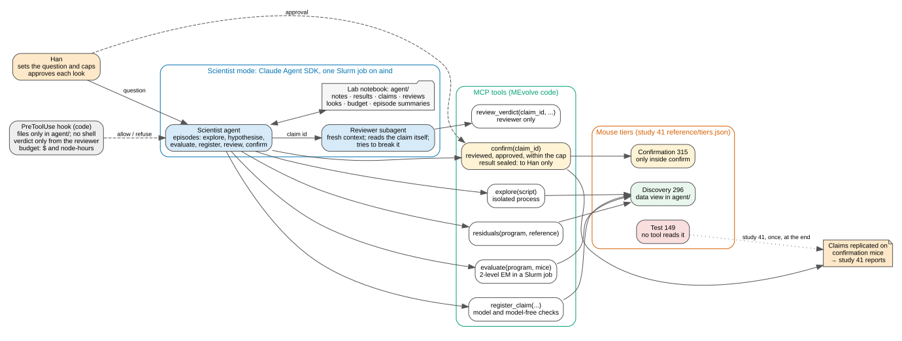

# Scientist mode: an agent that forms claims and confirms them on unused mice

**Status: proposed (#87).** Han reviews this ADR before any code is written. Rows marked **(Han)** are
proposals with a default for Han to set; the rest was decided with Han on 2026-11-12 (#87,
AllenNeuralDynamics/aind-dynamic-foraging-bfm-studies#149 and #148). "Studies #N" below means an
issue or PR in that repo.

Search mode optimises one pooled score. Study 40 showed that this score saturates (round 1) and that its
top programs tie because each add-on helps some mice and hurts others (r5). Study 41, the strategy
study (`41-cognitive-strategy-profiles`, studies #149 and #150), asks a different question: what is
each mouse's strategy, and why do mice differ? That needs a scientist's loop, not an optimiser: look
where models fail, form a hypothesis, test it, have it attacked, and confirm it once on mice that were
not used to find it.

MEvolve gets a third mode for this, **scientist mode** (`"mode": "scientist"`, next to `"search"` and
`"simplify"`). Search mode does not change. Study 41 is the first user; its question, mouse lists and
reports are its own (ADR 0002).

## Four terms

- An **agent** is a Claude model in a loop: it reads, calls a tool, sees the result, and decides the next
  call. The **Claude Agent SDK** (Python package `claude-agent-sdk`) runs this loop in our own process.
  It is the engine of Claude Code, used as a library.
- A **tool** is a function the agent calls by name with JSON arguments. We give our tools to the agent as
  an **MCP server** (Model Context Protocol, the standard way to give an agent tools). The SDK runs the
  server inside the harness's Python process, so each tool is plain Python that can read the freeze and
  submit Slurm jobs.
- A **hook** is our Python function that the SDK calls before every tool call (`PreToolUse`). It can
  allow or refuse the call. A rule in a hook is code and holds whatever the agent decides; a rule in a
  prompt is only a request.
- A **subagent** is a second agent with a fresh context and its own prompt. The main agent starts it
  through the SDK's `Agent` tool. The subagent's tool calls reach the same hooks with its `agent_type`
  attached, so a hook can tell them apart from the main agent's calls.

## Runtime

- The Claude Agent SDK for Python, pinned: `claude-agent-sdk==0.2.180`, which bundles the Claude Code
  CLI 2.1.321. The Linux wheel ships that CLI as a native binary, so the aind nodes need no Node.js.
- Its own conda env, `mevolve-scientist`, with MEvolve and the evaluator's dependencies, so the env of
  a running search (`mevolve-search`) never changes under it.
- One CPU Slurm job on partition `aind` runs the loop. Tools that fit programs submit their own Slurm
  jobs, as `eval_launch: "job"` does (#70), and wait for them. Those jobs get no API keys
  (`srun_eval.job_env`).
- The API key goes from `~/.config/mevolve/anthropic_api_key` into the loop's process only.
- The SDK starts with no settings files (`setting_sources=[]`), only our MCP server
  (`strict_mcp_config=True`), and `CLAUDE_CONFIG_DIR` inside the run directory. So no user's
  `CLAUDE.md`, memory, skills or MCP servers reach the agent, and its transcripts stay with the run on
  shared disk, not in a home directory.
- Not Claude Managed Agents: they run in Anthropic's cloud and cannot read /allen or submit Slurm jobs.

## The loop

The **scientist agent** (Claude, Opus 5.5 by default) works in **episodes**. An episode is one SDK
session with a fresh context that starts from the lab notebook.

1. The harness writes the episode's first message: the question (`QUESTION.md`), the notebook's index
   (hypotheses, claims and their states, budget left) and the summaries of the last episodes.
2. The scientist explores, forms a hypothesis, writes programs and evaluates them, registers a claim,
   asks the reviewer to break it, and asks for confirmation.
3. The episode ends when the scientist calls `end_episode(summary)`, or at the episode's turn or dollar
   cap. If it ends without a summary, the next episode's first message says so; the tools have already
   written every result to the notebook.
4. Inside an episode the SDK compacts the context when it fills. The notebook, not the context, is what
   carries across, so compaction and the end of an episode lose nothing that matters.
5. The Slurm job runs episodes until the budget is spent or `max_episodes` is reached. A later job
   continues from the same notebook at the next episode number.

## Tools

| tool | what it does | mice | build |
|---|---|---|---|
| `explore(script)` | Runs a Python script the scientist wrote in a separate process with MEvolve's isolation (#40): it reads only the discovery data view and Python's libraries, has no network and no subprocesses, and has time and memory limits. Returns its printed output and its figures (PNG), so the scientist sees the plots. | discovery | first |
| `evaluate(program, mice)` | Checks the program as the search does (`search.checks`). Fits it per mouse with `mevolve.evaluate.evaluate` (2-level EM with the per-mouse fallback, ADR 0004) in one Slurm job. Returns the pooled score, per-session held-out log-likelihoods (2-level and per subject, #85), MEvolve's replay fingerprints and the per-mouse parameters; saves per-trial p(right) for `residuals`. | discovery | first; rollout fingerprints second |
| `residuals(program, reference)` | The per-trial log-likelihood gap between a program and a reference, by mouse, session, task variant and training stage; by trial position after a block change in the second build (below). The reference is another evaluated program, or the GRU once its per-trial predictions exist (below). | discovery | first (program reference) |
| `register_claim(...)` | Writes a claim to the registry (next section) and runs its checks on discovery mice. | discovery | first |
| `review_verdict(claim_id, verdict, reasons)` | The reviewer's verdict; refused from anyone but the reviewer. | — | first |
| `confirm(claim_id)` | One look at the confirmation mice for a registered, reviewed, approved claim. | confirmation | first |
| `end_episode(summary)` | Writes the episode summary. | — | first |
| `shinka_polish(hypothesis, program)` | A short search-mode run around one idea (see "Later"). | discovery | later |

Rollout fingerprints (each fitted program plays the task, scored with study 15's fingerprint library)
come in the second build, by the pattern of study 40's `analysis/freeze_selection.py`. So does trial
position after a block change: the freeze keeps only choices and rewards (`freeze.py`), so the second
build adds each trial's reward probabilities to the discovery view, for analysis only, never as a
program input. Studies #149's
definition of understanding asks a model to generate realistic behaviour, so study 41's first real run
needs them.

**GRU residuals.** No per-trial GRU predictions exist for training-pool mice. The GRU v2 H128 (study
01) was trained on all 614 of them, so its predictions on discovery mice would be in-sample. If the
study makes such predictions, `residuals` labels them "in-sample, pointer only". `confirm` refuses a
claim whose checks use GRU predictions until the cross-validated GRU map exists for the confirmation
mice: study 17 (`17-gru-crossfit-predictability`, studies #148 and #151). The GRU's held-out protocol
scores every other session (`eval_every_n=2`), so `residuals` refuses a GRU reference whose scored
sessions are not the freeze's score sessions (`role == "score"`): the two must line up trial by
trial.

## Mouse tiers and the tier guard

| tier | mice | which | who reads it |
|---|---|---|---|
| discovery | 296 | study 40's four cohorts: generation 48, validation 48, selection 100, monitor 100 | the scientist, through its tools |
| confirmation | 315 | the training pool (614) minus discovery minus the 3 excluded | the `confirm` tool only |
| excluded | 3 | 764791, 808057, 823164: training-pool mice that are the GRU's extra test subjects (study 40 ADR 0003) | nobody; in no tier |
| test | 149 | the held-out pool | no tool; the study scores it once, outside scientist mode |

The lists are study 41's, frozen in its `reference/tiers.json` with the freeze manifest's sha256. MEvolve
does not draw them. The run config names that file and its sha256; the harness refuses to start if the
file's sha256 or its freeze manifest sha256 does not match, or unless each pool is split exactly:
discovery, confirmation and the excluded mice must partition the freeze's training pool (614), and the
test tier must equal its held-out pool (149). So no mouse is left out unseen, and no held-out mouse can
be swapped into discovery.

The guard has three layers, all code:

1. **Data views.** At start the harness writes a discovery view into the run's agent directory: the
   sessions and trials of the 296 discovery mice only, keyed by sha256. It is the only mouse data that
   `explore` and the agent's file tools can reach. The full freeze and the confirmation list are read
   only inside the `confirm` tool.
2. **No shell; files confined.** The scientist's built-in tools are `Read`, `Write`, `Edit`, `Glob`,
   `Grep` and `Agent` (for the reviewer); no `Bash` and no web tools. A `PreToolUse` hook resolves
   every path (symlinks too) and refuses any path outside the agent directory, and any write to a file
   the tools or Han own (claims, reviews, looks, budget, approvals, `QUESTION.md`, the data view). It
   refuses an `Agent` call for any subagent type but `reviewer` (the CLI's built-in types carry their
   own tools, `Bash` among them), and a reviewer call whose prompt is anything but a registered claim
   id.
3. **Tool checks.** `explore`, `evaluate` and `residuals` refuse any mouse outside discovery. `confirm`
   runs only for a claim that is registered, reviewed `not_broken` and approved, within the look cap.
   A claim's check functions never run in the harness's process: in both `register_claim` and
   `confirm` they run in the same isolated process as `explore` scripts (no file writes, no network,
   no subprocesses), on the view the tool passes them, and must return one finite number, which the
   tool validates; only the tool's own code writes it down. `confirm` returns nothing about the result
   to the agent (next section), so no confirmation value reaches the agent directory.

The tests of the first build (#87, second box) show each layer refusing:

- the discovery view holds no confirmation, excluded or test mouse;
- `Read`, `Glob` and `Grep` on the freeze, the confirmation list, `confirm/` or a symlink to them are
  refused;
  `Bash` is not available;
- `Write` and `Edit` on a claim, review, look, budget or approval file are refused;
- an `explore` script that opens the freeze fails with the isolation's `PermissionError`, and so does a
  claim's check function that opens a path or writes a file, in `register_claim` and in `confirm`; a
  check that returns anything but one finite number is refused;
- `evaluate`, `explore` and `residuals` with a confirmation or test mouse are refused;
- `review_verdict` from the scientist is refused, and so are a reviewer brief that is more than a
  claim id and an `Agent` call for any other subagent type;
- two tool calls at once whose jobs together need more node-hours than are left: the second is
  refused;
- a tier file that swaps one discovery mouse with one held-out mouse is refused at start;
- `confirm` is refused for a claim that is unregistered, changed since registration, unreviewed,
  reviewed `broken`, unapproved, past the look cap, or uses GRU predictions before studies #148's map
  exists.

## Claims, the reviewer and confirmation

A **claim** is a statement about the mice, written so that mice not used to find it can check it.
`register_claim` takes:

- the statement in words and the mechanism behind it;
- the programs it rests on (files, with sha256);
- a **model check**: a Python function that takes a set of mice (their data and the programs' fits) and
  returns one statistic, with a direction and a criterion (for example "mean per-mouse gain > 0");
- a **model-free check**: the same, on the raw choices and rewards only. Studies #149 asks every claim
  for a model-free signature.

The tool runs both checks on the discovery mice at registration and stores the results, so the record
shows what was seen before any look. A claim is immutable: its id is the sha256 of its contents, and a
changed claim is a new claim.

The **reviewer** is an SDK subagent: the same model, a fresh context, an adversarial prompt. It tries to
break the claim: other explanations, leakage between tiers, multiple comparisons, the fit-quality
confound of r5's caveat, a check that does not test the statement, a criterion chosen after looking.

- The scientist passes it only the claim id; the hook refuses any other brief. The reviewer reads the
  claim, its evidence and its code from the notebook itself, so the scientist cannot frame the
  evidence.
- Its tools are exactly `Read`, `Glob` and `Grep` on the agent directory, `explore` (discovery mice)
  and `review_verdict`: no `Write`, no `Agent`. The hook accepts `review_verdict` only when
  `agent_type` is `reviewer`.
- A `broken` verdict, with reasons, blocks the claim. The scientist may register a revised claim,
  which needs its own review.

A **look** is one run of a claim's two checks on all 315 confirmation mice, once. `confirm` first fits
the claim's programs on those mice (the same evaluator, in Slurm jobs) and keeps each fit in `confirm/`
under a key like the search's repeat cache (`shinka_eval.repeat_key`): the program's code, the freeze
manifest, the tier file, the fit settings and the evaluator's source digest. Claims that rest on the same
program reuse its fit only if all of these match, so node-hours grow with the number of programs, not of
looks; a fit on 315 mice costs about 3× a program in r5. Each statistic gets a bootstrap interval over
mice at confidence 1 − `look_alpha` / `max_looks` (Bonferroni over the study's whole look budget). The
claim passes only if both intervals lie on the claimed side of their criteria. A claim gets one look; a
revised claim spends a new one.

**Looks are sealed (Han).** The scientist never sees a look's result. `confirm` writes it to
`confirm/results.jsonl`, outside the agent directory, for Han; the agent's `looks.jsonl` records only
that the look is spent. So every claim is chosen from discovery data alone, the looks do not adapt to one
another, and the Bonferroni bound over `max_looks` holds. Every look is recorded, failures too, and the
report counts them all. Showing results to the scientist would let later claims adapt to the same 315
mice, and then no simple correction holds; if Han releases results, later claims need new mice (for
example mice recorded after the snapshot, studies #149's strongest test).

**Han approves each look (Han).** After a `not_broken` review, `confirm` returns "awaiting approval"
and the scientist goes on with other work. Han approves by creating `approvals/<claim_id>`; the next
`confirm` call on that claim runs the look.

## Lab notebook

| path in the run directory | written by | holds |
|---|---|---|
| `run.json` | Han | the config (outside the agent directory) |
| `agent/QUESTION.md` | Han | the question; read-only for the agents |
| `agent/data/discovery/` | harness | the discovery data view; read-only |
| `agent/notes/` | scientist | hypotheses, notes, scripts, programs |
| `agent/results/` | tools | outputs of `explore`, `evaluate` and `residuals` |
| `agent/claims/<id>.json` | `register_claim` | claims and their discovery results |
| `agent/reviews/<id>.md` | `review_verdict` | verdicts and reasons |
| `agent/approvals/<id>` | Han | approved looks |
| `agent/looks.jsonl` | `confirm` | which looks are spent; no results |
| `agent/budget.jsonl` | harness | dollars and node-hours spent |
| `agent/episodes/NNN.md` | `end_episode` | episode summaries |
| `confirm/` | `confirm` | fits on confirmation mice and `results.jsonl`, the looks' results, for Han (outside the agent directory) |
| `claude_config/` | the SDK | `CLAUDE_CONFIG_DIR`: transcripts (outside the agent directory) |

The run directory is on shared disk, outside any git checkout: the agents write to it often. The smoke
run uses scratch (`/allen/aind/scratch/han.hou/mevolve/scientist/smoke/`). Study 41 copies the
`agent/` directory, without the data views, into its `analysis/notebook/` and commits it as its record
(ADR 0002); how and when is the study's decision.

## Budget guard

One ledger, `budget.jsonl`, sums three costs:

- **agent dollars**: each episode's cost as the SDK reports it (`ResultMessage.total_cost_usd`, the
  scientist and its reviewer together). The smoke run checks it against the API's usage page.
- **`shinka_polish` dollars**, once that tool exists, from its own ledger (`search/claude.py`).
- **node-hours**: each Slurm job's elapsed time × its CPUs / 112 (one aind node), from `sacct`.

Each episode runs with the SDK's `max_budget_usd` set to the smaller of `max_usd_episode` and the
dollars left, so the SDK stops it at the cap. Node-hours are reserved before a job is submitted: under
a lock on the ledger, a tool writes a reservation for the job's full request (CPUs × time limit), and
the balance counts every open reservation as spent. A tool refuses a job, or a `confirm` all of its
fits, if the reservation does not fit, so tool calls that run at once cannot each spend the same
node-hours. When a job ends, is cancelled or is found by `sacct` after a restart, its reservation is
closed and replaced by its elapsed cost. The harness stops when either cap is spent.

## Config (`run.json`)

| key | default | meaning |
|---|---|---|
| `mode` | — | `"scientist"` |
| `run_dir` | — | the run directory (shared disk) |
| `question` | — | the question's file, copied to `agent/QUESTION.md` |
| `freeze` | — | the data freeze |
| `tiers` | — | the study's tier file (study 41 `reference/tiers.json`) and its sha256 |
| `model` | `claude-opus-5-5` **(Han)** | scientist and reviewer |
| `effort` | `medium` **(Han)** | as round 1's search |
| `max_usd` | 200 **(Han)** | API dollars for the run; about round 1's search cost |
| `max_usd_episode` | 25 **(Han)** | dollars per episode |
| `max_node_hours` | 100 **(Han)** | node-hours for the run |
| `max_episodes` | 20 | episodes per run |
| `max_turns` | 200 | turns per episode |
| `max_looks` | 15 **(Han)** | looks per study |
| `look_alpha` | 0.05 **(Han)** | family-wise error over `max_looks` |
| `eval_job_args` | — | `srun` options of the evaluation jobs |
| `gru_reference` | null | per-trial GRU predictions with sha256 and their kind (`in_sample` or `cross_validated`) |
| `wandb` | null | as in search mode: entity `NeuralDynamics`, project `dfbfm-mevolve` (ADR 0003). Study 41 has asked Han about its own project instead; that would amend ADR 0003 |

For scale: r5 fitted 17 programs on 100 mice in 17 jobs of 56 CPUs, 10 to 40 minutes each, about 4
node-hours in all.

## Build order

1. This ADR; Han reviews it.
2. **First build**: the tier-file checks, the data view, the tools marked "first", the hooks, the
   notebook, the tests above.
3. **Smoke run**: $10 and 5 node-hours, two episodes. A stand-in tier file puts the generation cohort in
   discovery and the validation cohort in confirmation, so no real confirmation mouse is read. It passes
   if the second episode starts from the first's notes and every refusal of the tier guard shows in the
   log.
4. **Second build**: rollout fingerprints in `evaluate`; reward probabilities in the data view and
   block position in `residuals`; GRU references in `residuals` once predictions exist.
5. Handed to study 41 for its first run.

## Later

- **`shinka_polish(hypothesis, program)`**: a short search-mode run seeded with one program, with the
  hypothesis in its task message, on cohorts drawn inside discovery. Built only if the scientist's own
  edits stall.
- **Tree search over hypotheses.** Ai2's AutoDiscovery (arXiv 2507.00310) has no set goal and rewards
  Bayesian surprise: how much a result shifts the model's own belief. It picks the next hypothesis to
  expand by Monte Carlo tree search with progressive widening. That search could pick ours, with the
  reward changed to "explains new structure on discovery mice". In the first build the scientist picks
  its next step itself.

## Considered options

- **Claude Managed Agents.** No server to run, but they run in Anthropic's cloud and cannot read /allen
  or submit Slurm jobs.
- **A shell for the scientist, in the SDK's sandbox.** More freedom for analysis. But the same user can
  read the full freeze, so the tier guard would rest on sandbox read rules that are not yet shown to
  work on Slurm nodes. `explore` gives the analysis freedom without the shell.
- **A reviewer started by code** (a second SDK session inside a `review` tool). Code would choose
  exactly what the reviewer sees, but it adds a second session to run and budget. A subagent whose brief
  the hook limits to a claim id, which reads the claim from the registry itself and alone may call
  `review_verdict` (gated by `agent_type`), gives the same guarantee.
- **SDK `resume` across episodes.** It replays the CLI's transcript. A fresh start from the notebook
  makes every episode's input a set of files Han can read and edit between runs.
- **The exploration agent of #35, feeding Shinka.** There the optimiser leads and the agent advises it.
  Scientist mode turns that around: the agent leads, and Shinka is at most one of its tools.
- **No approval of looks.** Faster, but looks are few and a spent look cannot be taken back.
